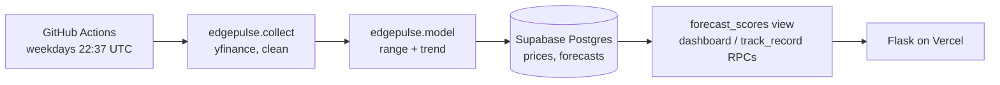

# EdgePulse

Daily prices, one-month price ranges and trend signals for seven commodity markets, with every forecast logged before the outcome is known and scored in public.

Live: [edgepulse.halim.pro](https://edgepulse.halim.pro)

## Why ranges instead of price targets

The first version of EdgePulse published 30-day price targets from a linear regression. When its 1,000+ predictions were scored against the simplest possible forecast, "the price stays where it is", the regression lost on every market (15.3% average error against 10.7%), its trend calls were right 51.7% of the time, and its "95% ranges" held only 48% of the time.

Version 2 stops pretending to predict prices. It answers a more useful question for budgets and contracts: **how far could this price realistically move in the next 30 days?** It also checks itself against baselines in public.

## Markets

| Market | Contract (Yahoo Finance) | Unit |
|---|---|---|
| Brent Oil | `BZ=F` | $ / barrel |
| Natural Gas | `NG=F` | $ / MMBtu |
| Gold | `GC=F` | $ / troy oz |
| USD Index | `DX-Y.NYB` | index points |
| Wheat | `ZW=F` | $ / bushel (converted from cents) |
| Corn | `ZC=F` | $ / bushel (converted from cents) |
| Rough Rice | `ZR=F` | $ / cwt |

One source and one unit per market. Mixing providers mid-series is what produced v1's fake 60% grain "crashes".

## Model

- **Volatility.** An exponentially weighted moving average of daily log returns (λ = 0.94).
- **90% range.** For every past day, the following 30-day move is divided by that day's volatility. The 5th and 95th percentiles of those standardized moves are scaled by today's volatility. Only outcomes already known on the forecast date are used, so there is no look-ahead.
- **Trend signal.** Up if the price is above its level 63 trading days ago, with a strength score of the move divided by expected volatility.

The same `Model.forecast` function produces live forecasts and backtests. The backtest uses one forecast a week per market over 10 years of history.

## Scoring

Forecasts are stored in Postgres (Supabase). A view joins each forecast with the first closing price on or after its due date and computes:

- **Range held**: target 90%
- **Trend right**: compared with a coin flip and with always predicting "up"

No evaluation script edits results after the fact. The score is derived from the stored forecast and the stored price.

## Architecture



```
edgepulse/assets.py    Markets, units, model constants
edgepulse/model.py     Cleaning, volatility, calibrated ranges, trend, backtest
edgepulse/collect.py   Yahoo Finance download
edgepulse/store.py     Supabase REST writes
edgepulse/run.py       daily | backfill entry point
web/                   Flask app, templates, styles
db/schema.sql          Tables, scoring view, RPCs, row level security
tests/                 pytest suite
```

## Running locally

```bash
pip install -r requirements-dev.txt
py -m pytest
py web/app.py
```

The pipeline needs `SUPABASE_SERVICE_ROLE` set:

```bash
py -m edgepulse.run backfill
py -m edgepulse.run daily
```

## Limitations

- Volatility estimates lag sudden shocks, so ranges are too narrow right after one.
- The trend signal is weak. It is shown with its record, not as advice.
- Front-month futures roll between contracts, and they are not the prices a business actually pays.

Not financial advice. Built by [Mohamed Abdulhalim](https://halim.pro).
